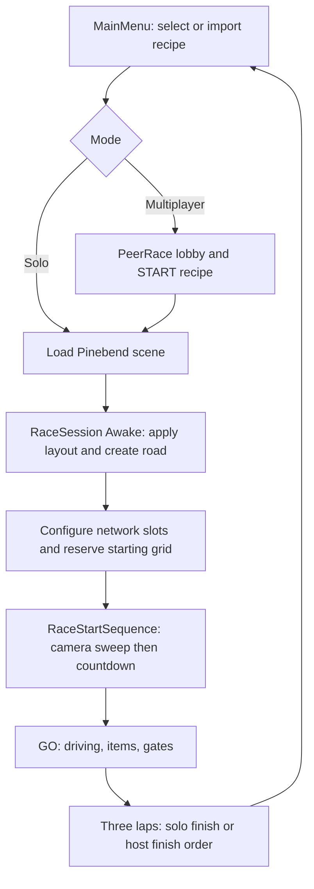

# Architecture and source map

## Environment

Unity version: `6000.6.8f1` (`237b6593792b`). Rendering uses URP; input uses the new Input System. Main menu and HUD use IMGUI (`OnGUI`), not a Canvas or UI Toolkit document. Runtime scripts live in `Assets/Pinebend`; editor-only utilities live in its `Editor` subfolder. There are no custom assembly definitions in this feature directory.

Relevant manifest versions at handover:

| Package | Version | Role |
|---|---|---|
| Universal RP | 17.6.0 | Rendering |
| Input System | 1.20.1 | Keyboard, mouse, partial gamepad input |
| Pipeline | 0.10.0-exp.1 | Local editor command automation |
| uGUI | 2.6.0 | Installed; main game UI is IMGUI |
| AI inference | 2.6.1 | Installed package; source of prior build shader warnings |
| AI assistant | 2.21.0-pre.2 | Installed editor tooling |

Use `Packages/manifest.json` and `Packages/packages-lock.json` as the dependency source of truth. Do not upgrade packages as an incidental part of a gameplay task.

## Runtime responsibilities

| File under `Assets/Pinebend` | Responsibility |
|---|---|
| `Tracks/MainMenu.cs` | Solo/multiplayer pages, selection, generation, save/import, responsive preview |
| `Tracks/TrackRecipe.cs` | Serializable recipe, version dispatch and local file library |
| `Tracks/CircuitGenerator.cs` | Seeded closed layouts and style selection |
| `Tracks/CircuitJunction.cs` | Clip intersecting geometry and add one shared junction surface |
| `Tracks/RaceSession.cs` | Three-lap session, layout application, road/grid/start creation, solo finish/menu |
| `StartingGrid.cs` | Arc-length grid reservations, terrain and obstacle checks |
| `RaceStartSequence.cs` | Camera introduction, countdown, motion/input hold and GO |
| `TestCar.cs` | Physics, input, recovery, health, lap/progress, visual body/wheels, chase camera, network state |
| `RallyBot.cs` | Route pursuit, braking, overtaking, recovery and item tactics |
| `RallyWeapons.cs` | Inventory, item reveal, target selection, projectile/hitscan/trap simulation and effects |
| `RallyWeaponInput.cs` | Mouse/gamepad sight and weapon commands, rear view |
| `RallyAmmoPickup.cs` | Authority-only collection and eight-second box cooldown |
| `CarPowerState.cs` | Timed shield/turbo and repair rules with explicit time arguments |
| `GameplayBalance.cs` | Shared fixed odds, shield settings, bot profiles |
| `CountermeasureBurst.cs` | Six visual flares, seeker lure selection and lifecycle |
| `OilSpill.cs`, `WreckSmoke.cs` | Oil entry/lifetime rules and smoke obscurity |
| `RallyRoad.cs` | Driving mesh, jumps, runoff, cumulative craters, spawn probes, map edges |
| `TimingGate.cs` | Forward trigger passage delegated to the car |
| `CircuitMap.cs`, `RallyHud.cs` | Shared map projection and race HUD |
| `RallyDust.cs`, `CarPowerFeedback.cs` | Drift dust and shield/turbo/repair feedback |
| `RallyCarModel.cs` | Mesh-only body/wheel replacement adapter |
| `Network/PeerRace.cs` | Lobby/session, authority, control transport, snapshots, finish and disconnect |
| `Network/PeerLink.cs` | Bounded newline-framed TCP transport with asynchronous writes |
| `Network/RaceProtocol.cs` | Wire DTOs, handshake version and input validation |
| `Network/RaceReplication.cs`, `Network/ReplicatedProp.cs` | World events, prop IDs and guest prop interpolation |

## Startup and race lifecycle

`RaceSession` has execution order -1000; `PeerRace` uses -500. Layout and road setup, network grid configuration, and starting reservations happen before `TestCar.Awake`. Car initialization builds a sprung visual shell and adds weapon/effect components. Only the local car adds weapon input and HUD. A local car builds the shared pickup rows. Multiplayer waits for every active grid to report ready before starting the introduction/countdown.

Solo uses the same authority branches as the host. On guests, all cars are kinematic proxies, WheelColliders are disabled, and the local driver's commands go to the host. Guest hull colliders remain queryable for aiming. `PeerRace.IsLocal` is about input/camera ownership; `IsProxy` is about simulation. They are not interchangeable.

## Scene contracts and refactoring risks

The runtime is still coupled to the authored race scene. `RaceSession` and `RallyRoad` find objects by exact names, including `Apricot gravel`, `Grass and driving surface`, `Pinebend - grounds`, and `D oval - sand circuit`. Child-name conventions include `Fir`, curb names and `Finish tile`. Each racer must have four WheelColliders/visual wheel sockets, a Rigidbody, a hull, and the shared ordered route. Wheels 0/1 are front and 2/3 rear.

The route currently has **128 markers**, with four gates at indices 0, 32, 64 and 96. Multiple algorithms hardcode 128; increasing sample count requires coordinated changes. Multiplayer slots sort cars by ordinal name; changing names or per-build scene content can change slot identity. The default scene holds eight cars.

`CircuitBuilder.Create()` rebuilds the scene and generated assets; it is not the build command. It can overwrite authored scene/model assignments. `RallyGrid.Install()` is also an authoring utility, not a runtime requirement. Use `CircuitBuilder.Build()` for ordinary builds.

Static registries and singleton-like state include `TestCar.Racers`, `RallyRoad.Instance`, `RaceSession.Selected`, cached `GameplayBalance.Current`, `PeerRace.session` and replication registries. Preserve their cleanup/reset behavior when changing scene transitions. The scene is reloaded between races; there is no save of live race state.
